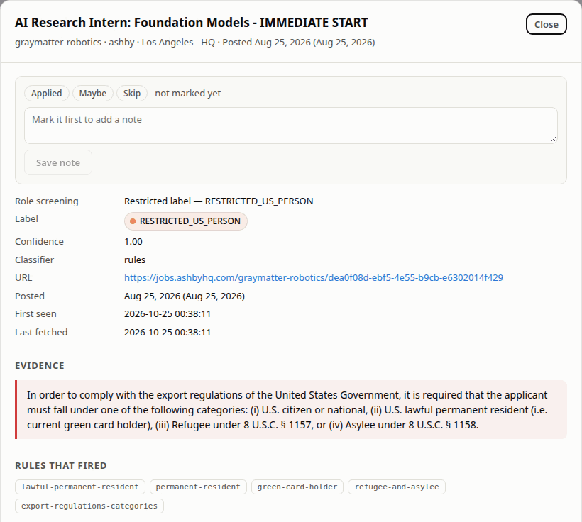
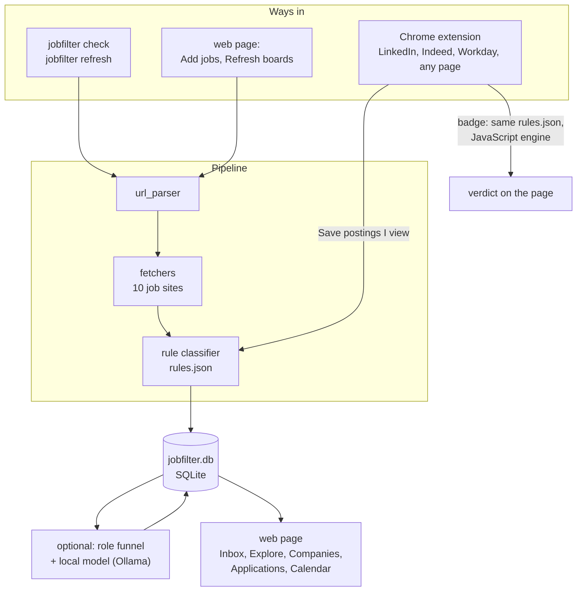

# jobfilter

[](https://www.python.org/downloads/)
[](LICENSE)
[](docs/HOW-IT-WORKS.md#testing)
[](docs/SITES.md)
[](extension/)
[](https://ollama.com)
[](#privacy)
[](pyproject.toml)

A local job-search workbench: find postings, check whether you can apply, and track your
applications.

It flags postings limited to U.S. citizens, U.S. persons (ITAR / EAR) or clearance
holders, and quotes the sentence that says so. Everything runs on your machine and lives
in one SQLite file.

<p align="center"></p>

## What it does

**Find postings**
- Reads 10 job sites: Ashby, Greenhouse, Lever, Workday, Dover, Rippling,
  SmartRecruiters, Workable, Eightfold and Amazon Jobs.
- Pulls in a whole company at once, and `refresh` reports new and closed jobs.
- A Chrome extension checks LinkedIn, Indeed and Workday postings as you browse.

**Decide what to apply to**
- Restriction check by rules, so verdicts are repeatable. Ignores EEO boilerplate,
  understands "no clearance required", and sends hedged wording to you for review.
- Filters by your location, seniority and kind of work (`profile.json`).
- Optional local model (Ollama) rates what's left as fit, stretch or skip.
- Ranks postings by how many of your skills they mention.
- Flags apply-by dates that are close.

**Track your applications**
- Mark postings Applied, Maybe or Skip, with notes.
- Record each step: OA, interview, offer, rejection.
- Attach the resume you sent and see which resumes get replies.
- Calendar of applications per day.

### Restriction labels

| Label | Meaning |
|---|---|
| `RESTRICTED_CITIZEN` | U.S. citizens only |
| `RESTRICTED_US_PERSON` | citizen, green card, refugee or asylee (ITAR / EAR) |
| `RESTRICTED_CLEARANCE` | security clearance required, or eligibility for one |
| `INFO_NO_SPONSORSHIP` | no visa sponsorship (shown, not counted as a restriction) |
| `UNCLEAR` | ambiguous: read it yourself |
| `OPEN` | no restriction found |

The most restrictive match wins. A link that can't be read still gets a row saying why.

## Get started

Needs Python 3.11+. Chrome and Ollama are optional.

```bash
make venv install                       # or: python3 -m venv .venv && .venv/bin/pip install -e '.[dev]'
cp profile.example.json profile.json    # your preferences (git-ignored)
source .venv/bin/activate

jobfilter check urls.txt                # a file of job links, one per line
jobfilter check urls.txt --expand       # plus every other job at those companies
jobfilter serve --open                  # the web page at http://127.0.0.1:8000
```

```
COMPANY              TITLE                               LABEL                 EVIDENCE
graymatter-robotics  AI Research Intern: Foundation Mo…  RESTRICTED_US_PERSON  In order to comply with the export r…
rai                  Autonomous Agent Engineering Inte…  OPEN                  -
```

[USAGE.md](USAGE.md) has every command, the web page, the extension and troubleshooting.

## Screenshots

The Inbox: postings that passed your rules, best fits first.


The extension on a job page (a test page laid out like LinkedIn):


More in [USAGE.md](USAGE.md#the-web-page). Screenshots use demo data.

## How it fits together



Details in [HOW-IT-WORKS.md](docs/HOW-IT-WORKS.md); plans in [ROADMAP.md](docs/ROADMAP.md).

## Supported links

| Site | Job link |
|---|---|
| Ashby | `jobs.ashbyhq.com/{company}/{job id}` |
| Greenhouse | `job-boards.greenhouse.io/{company}/jobs/{job id}` |
| Lever | `jobs.lever.co/{company}/{job id}` |
| Workday | `{tenant}.wd{N}.myworkdayjobs.com/…/job/…_{req id}` |
| Dover | `app.dover.com/apply/{Company}/{job id}` |
| Rippling | `ats.rippling.com/{company}/jobs/{job id}` |
| SmartRecruiters | `jobs.smartrecruiters.com/{Company}/{id}-{title}` |
| Workable | `apply.workable.com/{company}/j/{code}` |
| Eightfold | `{careers host}/careers/job/{id}` |
| Amazon Jobs | `amazon.jobs/en/jobs/{id}/…` |
| Company careers page | only with `?gh_jid=` or `?ashby_jid=` in the link |

Board and search links work for several sites too; see [SITES.md](docs/SITES.md).

**Link says "unsupported"?**
- Company careers page: add the job number, e.g.
  `x.company/careers/8807323002/?gh_jid=8807323002`.
- API address (`boards-api.greenhouse.io/…`): use the job page link instead.
- LinkedIn or Indeed: use the extension.

## Docs

| | |
|---|---|
| [USAGE.md](USAGE.md) | everyday use and troubleshooting |
| [SITES.md](docs/SITES.md) | supported links and how each site is read |
| [HOW-IT-WORKS.md](docs/HOW-IT-WORKS.md) | how decisions are made |
| [EXTENDING.md](docs/EXTENDING.md) | change a rule, add a site, add a filter |
| [HTTP-API.md](docs/HTTP-API.md) | the local server's endpoints |
| [CHANGELOG.md](docs/CHANGELOG.md) | rule and database versions |
| [RESUME-WORKFLOW.md](docs/RESUME-WORKFLOW.md) | tailoring resumes alongside jobfilter |
| [ROADMAP.md](docs/ROADMAP.md) | what's planned |

## Project layout

```
jobfilter/
  url_parser.py     link -> ParsedUrl
  fetchers/         one per job site: fetch(ParsedUrl) -> Posting
  classifiers/      classify(Posting) -> Decision
  storage/          SQLite store and schema
  roles/            role funnel, model reader, skill match
  web/              local server and page
  cli.py            the `jobfilter` command
rules.json          restriction patterns (shared with the extension)
role_rules.json     what a job title means
extension/          Chrome extension
tests/              pytest suite, offline fixtures
```

## Tests

```bash
make test         # offline
make test-live    # against the real sites
```

Browser tests need Chrome and skip without it.

## Limits

- Tuned on U.S. engineering postings. Read the quoted sentence before acting on a verdict.
- The LinkedIn and Indeed extension fixtures are hand-built, so selectors can go stale.
- Not built yet: a Playwright fetcher, board links for Ashby / Greenhouse / Lever, model
  classifiers, a Firefox extension. See [ROADMAP.md](docs/ROADMAP.md).

## Credits

Ideas came from these projects' READMEs (no code was taken):

| Project | Idea |
| --- | --- |
| [aryanyeole/job-watcher](https://github.com/aryanyeole/job-watcher) | per-ATS endpoint survey |
| [ChristianMangwanda/veritas-research-radar](https://github.com/ChristianMangwanda/veritas-research-radar) | negation-aware patterns |
| [Aiyan17/internship-tracker](https://github.com/Aiyan17/internship-tracker) | flag ITAR postings, don't drop them |
| [Julius-PC/jay-oh-bee](https://github.com/Julius-PC/jay-oh-bee) | "itar" matching inside "military" |
| [mkori808/cleared-jobs-assistant](https://github.com/mkori808/cleared-jobs-assistant), [Rockaide/Job-Scrapper-app](https://github.com/Rockaide/Job-Scrapper-app), [Ahmedshaikh77/Job-tracker-robotics](https://github.com/Ahmedshaikh77/Job-tracker-robotics), [Imanol2006/jobs_scraper](https://github.com/Imanol2006/jobs_scraper) | related trackers and scrapers |

Documented APIs: [Greenhouse](https://developers.greenhouse.io/job-board.html),
[Lever](https://github.com/lever/postings-api), [Ashby](https://developers.ashbyhq.com),
[SmartRecruiters](https://developers.smartrecruiters.com). The other sites' endpoints were
found in the browser's network tab.

Built with help from Claude (Anthropic).

### Related projects

| Project | What it is |
| --- | --- |
| [speedyapply/JobSpy](https://github.com/speedyapply/JobSpy) | scrapes LinkedIn, Indeed, Glassdoor and more |
| [spinlud/py-linkedin-jobs-scraper](https://github.com/spinlud/py-linkedin-jobs-scraper) | LinkedIn scraper |
| [PaulMcInnis/JobFunnel](https://github.com/PaulMcInnis/JobFunnel) | job sites into a spreadsheet (archived) |
| [adgramigna/job-board-scraper](https://github.com/adgramigna/job-board-scraper) | Greenhouse / Lever / Ashby pipeline |
| [Riley-Dorrington/job-board-aggregator](https://github.com/Riley-Dorrington/job-board-aggregator) | 1M+ postings from ATS boards, daily |
| [gzchenhao/openhire](https://github.com/gzchenhao/openhire) | ATS job search as an MCP server |
| [weberwcwei/job-scout](https://github.com/weberwcwei/job-scout) | scrape, score and alert CLI |
| [SimplifyJobs/New-Grad-Positions](https://github.com/SimplifyJobs/New-Grad-Positions), [Summer2027-Internships](https://github.com/SimplifyJobs/Summer2027-Internships) | curated lists, hand-marked for citizenship and sponsorship |
| [vanshb03/Summer2027-Internships](https://github.com/vanshb03/Summer2027-Internships) | curated internship list |
| [Gsync/jobsync](https://github.com/Gsync/jobsync) | self-hosted application tracker |
| [srbhr/Resume-Matcher](https://github.com/srbhr/Resume-Matcher) | tailor resumes to job descriptions |
| [emredurukn](https://github.com/emredurukn/awesome-job-boards) / [tramcar](https://github.com/tramcar/awesome-job-boards) awesome-job-boards | lists of niche job boards |

## Privacy

`jobfilter.db`, `profile.json` and `DownloadedPagesTest/` are personal and git-ignored.
No API keys are needed; if you add one, keep it in the environment or `~/.config/jobfilter/`.

## License

[MIT](LICENSE) © 2026 Shubhamd13
