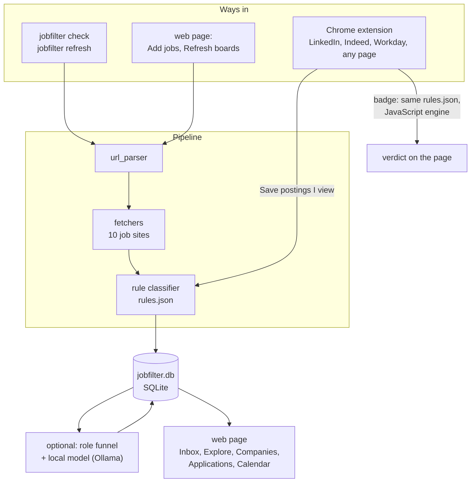

# jobfilter

[](https://www.python.org/downloads/)
[](LICENSE)
[](docs/HOW-IT-WORKS.md#testing)
[](docs/SITES.md)
[](extension/)
[](https://ollama.com)
[](#privacy)
[](pyproject.toml)

Paste a job link, find out whether you are allowed to apply.

jobfilter fetches the full text of a job posting and decides whether it limits who may
apply: U.S. citizens only, U.S. persons (export control, ITAR / EAR), or a security
clearance. Every decision comes with **the exact sentence it was based on**, so you can
check it in a second instead of reading the whole posting.

It runs on your own computer. Postings, verdicts and your notes live in one SQLite file;
nothing is sent anywhere except the requests to the job sites themselves.

```
COMPANY              TITLE                               LABEL                 EVIDENCE
-------------------  ----------------------------------  --------------------  -------------------------------------
graymatter-robotics  AI Research Intern: Foundation Mo…  RESTRICTED_US_PERSON  In order to comply with the export r…
rai                  Autonomous Agent Engineering Inte…  OPEN                  -
```

## What it does

- **Restriction check**: rules, not a model, so every verdict is repeatable and quotes its
  reason. EEO boilerplate ("protected veteran status", "national origin") is ignored,
  negations ("no clearance required") are understood, and hedged wording ("may require")
  is sent for human review instead of being called a bar.
- **Many job sites**: Ashby, Greenhouse, Lever, Workday, Dover, Rippling, SmartRecruiters,
  Workable, Eightfold (Qualcomm, Microsoft, Netflix, …) and Amazon Jobs, through their
  public JSON. **Whole companies** in one go, and a **refresh** that reports new, edited
  and closed jobs.
- **Chrome extension**: a badge on LinkedIn, Indeed and Workday job pages, or on any page
  on request, using the same rules file.
- **Local web page**: inbox, filters (label, location, company, posted date, deadline),
  per-company counts and board refresh.
- **Optional, for your own search**: a role funnel driven by your `profile.json` (title
  rules, location, seniority), a local model through [Ollama](https://ollama.com) that
  reads what the rules let through, skill matching, apply-by deadlines, and an
  application tracker (steps reached, which resume you sent).

### Labels

| Label | Meaning |
|---|---|
| `RESTRICTED_CITIZEN` | U.S. citizens only |
| `RESTRICTED_US_PERSON` | citizen, green card holder, refugee or asylee (ITAR / EAR wording) |
| `RESTRICTED_CLEARANCE` | a security clearance is required, or being eligible for one |
| `INFO_NO_SPONSORSHIP` | says it offers no visa sponsorship. Shown for information, not counted as a restriction |
| `UNCLEAR` | some signal, but ambiguous: read it yourself |
| `OPEN` | no restriction found |

When a posting matches several, the most restrictive wins; when it contradicts itself, it
is `UNCLEAR`. Nothing is dropped: a link that cannot be read still produces a row saying
why.

## Install

Needs Python 3.11 or newer. Chrome is optional (for the extension, and for the browser
tests). Ollama is optional (for the model step only).

```bash
cd jobfilter                              # the project folder
make venv install                         # Python 3.12 virtualenv via uv, project installed into it
cp profile.example.json profile.json      # your preferences; git-ignored
source .venv/bin/activate                 # puts the `jobfilter` command on your PATH
```

Without `uv`: `python3 -m venv .venv && .venv/bin/pip install -e '.[dev]'`.

## Quick start

```bash
jobfilter check urls.txt                  # a file of links, one per line (# for comments)
jobfilter check 'https://jobs.lever.co/rai/dff73976-3e91-4897-af10-8d2433c63204'
jobfilter check urls.txt --expand         # also every other job at those companies
jobfilter serve --open                    # the web page, at http://127.0.0.1:8000
```

`check` prints a table, stores the results in `./jobfilter.db` and, with `--out
results.jsonl`, writes one JSON line per link. [USAGE.md](USAGE.md) has every everyday
command, the web page, the extension and troubleshooting.

## How it fits together



Each box is a module with a small interface, so one can be swapped without touching the
others. [docs/HOW-IT-WORKS.md](docs/HOW-IT-WORKS.md) walks through each;
[docs/ROADMAP.md](docs/ROADMAP.md) shows what is planned next.

## Links it understands

| Site | Example job link |
|---|---|
| Ashby | `jobs.ashbyhq.com/{company}/{job id}` |
| Greenhouse | `job-boards.greenhouse.io/{company}/jobs/{job id}` (also `boards.greenhouse.io`) |
| Lever | `jobs.lever.co/{company}/{job id}` |
| Workday | `{tenant}.wd{N}.myworkdayjobs.com/…/job/…_{req id}`, and board links |
| Dover | `app.dover.com/apply/{Company}/{job id}` |
| Rippling | `ats.rippling.com/{company}/jobs/{job id}`, and board links |
| SmartRecruiters | `jobs.smartrecruiters.com/{Company}/{id}-{title}`, and board links |
| Workable | `apply.workable.com/{company}/j/{code}`, `jobs.workable.com/view/…`, and board links |
| Eightfold | `{careers host}/careers/job/{id}`, and search links |
| Amazon Jobs | `amazon.jobs/en/jobs/{id}/…`, and team links |
| A company's own careers page | only when the link carries `?gh_jid=` (Greenhouse) or `?ashby_jid=` (Ashby) |

[docs/SITES.md](docs/SITES.md) lists every accepted shape, what each site costs in
requests, and its quirks.

### When a link is "unsupported"

Most failures are a link that does not say which job board it belongs to. The common
cases:

- **A company's own careers page.** `https://x.company/careers/8807323002/` is a Greenhouse
  job (board `x9`), but nothing in the link says so. Add the job number as `gh_jid`:
  `https://x.company/careers/8807323002/?gh_jid=8807323002`. jobfilter then asks
  Greenhouse which board the job belongs to. Use `?ashby_jid=` the same way for an Ashby
  job. If you can't tell which site a page uses, its **Apply** button or its page
  source names it (`greenhouse.io`, `ashbyhq.com`).
- **An API address**, such as `boards-api.greenhouse.io/v1/boards/x9/jobs/8807323002`. Use
  the job page instead: `job-boards.greenhouse.io/x9/jobs/8807323002`. API addresses are
  only accepted for SmartRecruiters, Workable and Eightfold.
- **A company board** on Ashby, Greenhouse or Lever (`jobs.ashbyhq.com/acme`). Give one of
  its job links and add `--expand`.
- **LinkedIn or Indeed.** They have no public API; use the browser extension.

A job that has closed comes back as `JobNotFound`, and a network error as
`TransportFailure`, each with the link, under "Could not be checked" on the web page.

## Documentation

| Document | For |
|---|---|
| [USAGE.md](USAGE.md) | Everyday use: commands, the web page, the extension, settings, troubleshooting |
| [docs/SITES.md](docs/SITES.md) | Every supported link shape and how each site is read |
| [docs/HOW-IT-WORKS.md](docs/HOW-IT-WORKS.md) | How decisions are made: the rules engine, storage, refresh, role screening, the extension |
| [docs/EXTENDING.md](docs/EXTENDING.md) | Step-by-step changes: your profile, a rule, a location, a new job site, a filter, a table |
| [docs/HTTP-API.md](docs/HTTP-API.md) | The local server's endpoints |
| [docs/CHANGELOG.md](docs/CHANGELOG.md) | Rule and database versions, and what each changed |
| [docs/RESUME-WORKFLOW.md](docs/RESUME-WORKFLOW.md) | A worked story: tailoring a resume per posting in a separate repo, and using the gaps to decide what to learn next |
| [docs/ROADMAP.md](docs/ROADMAP.md) | What is planned: a Playwright fetcher, a careers-page probe, model classifiers, application steps from your email, CI |

## Project layout

```
jobfilter/
  url_parser.py        link -> ParsedUrl(platform, slug, job_id). Pure, never raises
  fetchers/            one fetcher per site: fetch(ParsedUrl) -> Posting
  classifiers/         classify(Posting) -> Decision (label, evidence, rule)
  storage/             SQLite store and schema
  refresh.py           re-read stored companies' boards, report what changed
  roles/               role funnel, local model reader, skill match
  location.py          where a posting is (US / outside / unknown)
  deadline.py          apply-by dates;  posted.py: posting dates
  web/                 local server (standard library) and the page in static/
  cli.py               the `jobfilter` command
rules.json             every restriction pattern, shared by Python and the extension
role_rules.json        what a job title means (HR, staff-level, mechanical, …)
profile.example.json   template for your own profile.json
extension/             Chrome extension (Manifest V3)
tests/                 pytest suite; fixtures/ holds saved real responses
```

## Tests

```bash
make test          # the whole suite, offline (saved responses, no network, no model)
make test-live     # the tests that call the real sites, to catch an API changing shape
```

The JavaScript engine and the browser tests run in headless Chrome and are skipped when
Chrome is not installed. If pytest dies loading a plugin from another Python
installation (ROS is a known case, through `PYTHONPATH`), run it as `.venv/bin/python -E
-m pytest`; `make test` already does.

## Status and limits

- The rules are tuned on U.S. engineering postings. Read the quoted sentence before you
  act on a verdict, especially `UNCLEAR`.
- The LinkedIn and Indeed page fixtures were built by hand from those sites' page
  structure, so the extension's selectors can go stale. When the badge says "Couldn't
  read this posting", [docs/HOW-IT-WORKS.md](docs/HOW-IT-WORKS.md#when-a-site-changes-its-page)
  explains how to replace the fixture.
- Not built yet: a browser-based (Playwright) fetcher for career sites with no JSON at
  all, board links for Ashby / Greenhouse / Lever, model classifiers for `UNCLEAR`
  postings, a Firefox build of the extension. [docs/ROADMAP.md](docs/ROADMAP.md) has the
  designs.

## Credits and prior art

These projects shaped the approach. Their READMEs were read for ideas; no code was taken
from them.

| Project | What it contributed |
| --- | --- |
| [aryanyeole/job-watcher](https://github.com/aryanyeole/job-watcher) | the per-ATS endpoint survey (Greenhouse, Lever, Workday, Ashby, SmartRecruiters) |
| [ChristianMangwanda/veritas-research-radar](https://github.com/ChristianMangwanda/veritas-research-radar) | negation-aware restriction patterns |
| [Aiyan17/internship-tracker](https://github.com/Aiyan17/internship-tracker) | flag ITAR postings, don't drop them |
| [Julius-PC/jay-oh-bee](https://github.com/Julius-PC/jay-oh-bee) | the "`itar` matches inside `military`" trap, hence word boundaries |
| [mkori808/cleared-jobs-assistant](https://github.com/mkori808/cleared-jobs-assistant), [Rockaide/Job-Scrapper-app](https://github.com/Rockaide/Job-Scrapper-app), [Ahmedshaikh77/Job-tracker-robotics](https://github.com/Ahmedshaikh77/Job-tracker-robotics), [Imanol2006/jobs_scraper](https://github.com/Imanol2006/jobs_scraper) | related job scrapers and trackers |

Public APIs are used as documented by
[Greenhouse](https://developers.greenhouse.io/job-board.html),
[Lever](https://github.com/lever/postings-api), [Ashby](https://developers.ashbyhq.com) and
[SmartRecruiters](https://developers.smartrecruiters.com). The Workday, Amazon, Eightfold,
Workable, Rippling and Dover endpoints are undocumented; they were found by watching each
site's own network requests in the browser
([SITES.md](docs/SITES.md#where-the-endpoints-come-from)).

Planned model classifiers would use
[facebook/bart-large-mnli](https://huggingface.co/facebook/bart-large-mnli) (zero-shot) and
[Jev](https://typesafe.ai/blog/introducing-system-one-models-and-jev). Related browser
extensions include VisaCheck, FrogHire, GlanceJobs and Interstride.

The design and much of the code were developed with help from Claude (Anthropic).

### Related projects

Well-known open-source work in the same space, for comparison or as a starting point.
Different goals, so pick what fits.

**Job board scrapers** (LinkedIn, Indeed and other aggregators):

- [speedyapply/JobSpy](https://github.com/speedyapply/JobSpy): the best-known; LinkedIn,
  Indeed, Glassdoor, ZipRecruiter and more into one table. Those sites block
  aggressively, which is why jobfilter reads LinkedIn and Indeed through an extension
  instead.
- [spinlud/py-linkedin-jobs-scraper](https://github.com/spinlud/py-linkedin-jobs-scraper):
  LinkedIn only.
- [PaulMcInnis/JobFunnel](https://github.com/PaulMcInnis/JobFunnel): job sites into one
  deduplicated spreadsheet. Archived (read-only) since December 2025.

**Applicant-system (ATS) pipelines and aggregators**, closest to jobfilter's fetchers:

- [adgramigna/job-board-scraper](https://github.com/adgramigna/job-board-scraper)
  ("Levergreen"): Scrapy spiders for Greenhouse, Lever, Ashby and Rippling, Postgres and
  dbt, a daily GitHub Actions run. A reference architecture rather than a library.
- [Riley-Dorrington/job-board-aggregator](https://github.com/Riley-Dorrington/job-board-aggregator):
  over a million postings from ~20,000 companies across Greenhouse, Lever, Ashby, Workday
  and more, refreshed daily. Commercial use of its datasets needs permission.
- [gzchenhao/openhire](https://github.com/gzchenhao/openhire): searches employers' own ATS
  APIs (many robotics and autonomous-driving companies), scores "ghost job" likelihood,
  and runs as an MCP server for AI assistants.
- [weberwcwei/job-scout](https://github.com/weberwcwei/job-scout): a CLI that scrapes six
  boards, scores matches against your profile, and sends alerts.

**Curated job lists:**

- [SimplifyJobs/Summer2027-Internships](https://github.com/SimplifyJobs/Summer2027-Internships)
  and [SimplifyJobs/New-Grad-Positions](https://github.com/SimplifyJobs/New-Grad-Positions):
  community-maintained lists that mark postings 🇺🇸 "Requires U.S. Citizenship" and 🛂
  "Does NOT offer sponsorship", the same distinction jobfilter draws automatically. Useful
  as a job source and as hand-labeled data to test the classifier against.
- [vanshb03/Summer2027-Internships](https://github.com/vanshb03/Summer2027-Internships):
  another widely used internship list.

**Applications and resumes:**

- [Gsync/jobsync](https://github.com/Gsync/jobsync): a self-hosted job application tracker
  with AI resume help.
- [srbhr/Resume-Matcher](https://github.com/srbhr/Resume-Matcher): tailors resumes to job
  descriptions with local or hosted LLMs; relevant to fit scoring.

**Lists of job boards:**
[emredurukn/awesome-job-boards](https://github.com/emredurukn/awesome-job-boards) and
[tramcar/awesome-job-boards](https://github.com/tramcar/awesome-job-boards), curated niche
boards (AI, Python, remote, …). Handy for finding robotics-focused companies to add.

## Privacy

- `jobfilter.db`, `profile.json` and anything under `DownloadedPagesTest/` are personal
  and git-ignored. Don't commit them.
- No API keys are needed. If you add an integration that needs one, read it from the
  environment or `~/.config/jobfilter/`, never from a file in the repository.

## License

[MIT](LICENSE) © 2026 Shubhamd13
