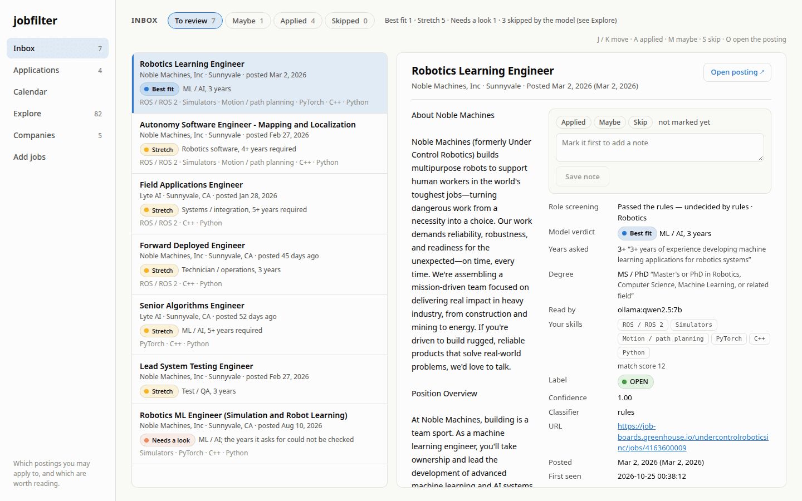
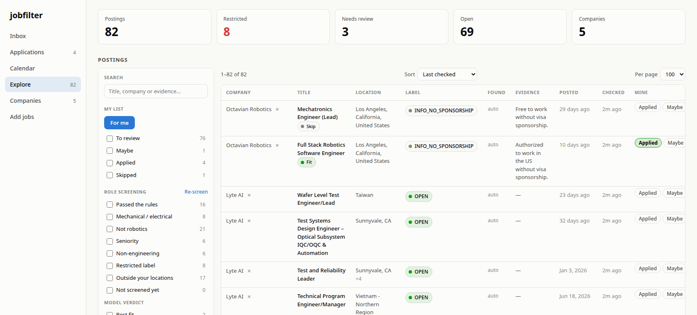
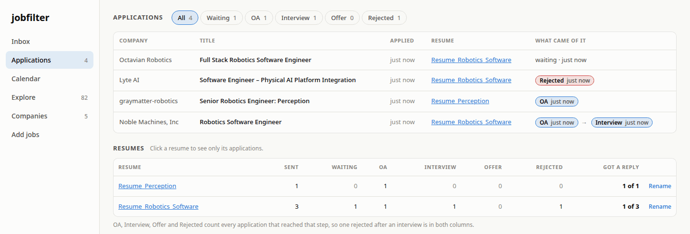
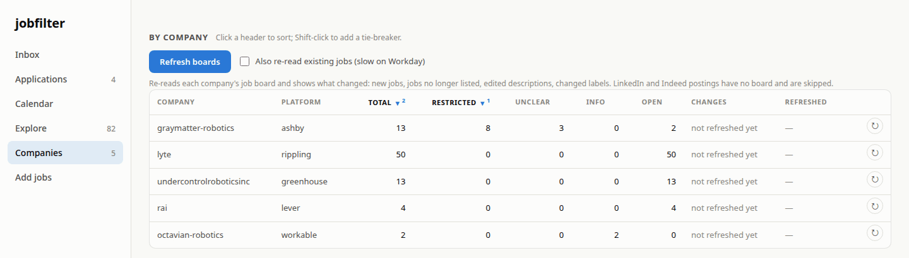
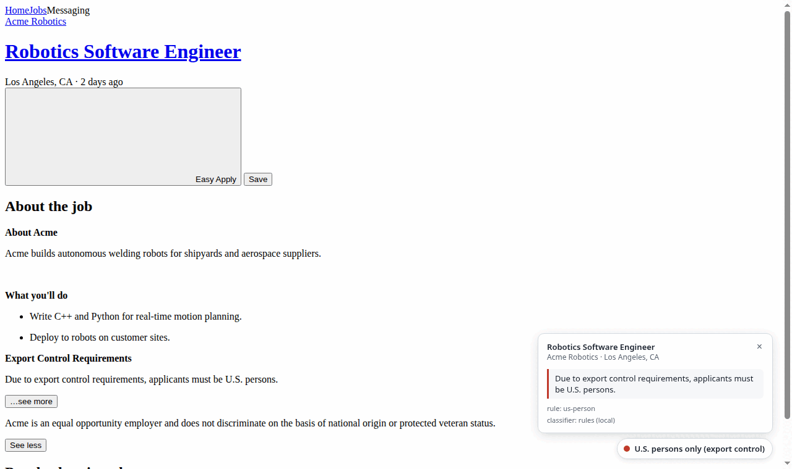

# Using jobfilter

The commands for everyday use. [README.md](README.md) covers installing it;
[docs/HOW-IT-WORKS.md](docs/HOW-IT-WORKS.md) explains how each part decides;
[docs/EXTENDING.md](docs/EXTENDING.md) covers changing it.

## Before you start

From the project folder, once:

```bash
make venv install                       # Python 3.12 virtualenv with the project installed
cp profile.example.json profile.json    # then edit it: your locations, degree, skills
ollama pull qwen2.5:7b                  # only for the model step (`jobfilter read`)
```

Then, in each new shell:

```bash
source .venv/bin/activate               # puts `jobfilter` on your PATH
```

Without activating, the same commands work as `.venv/bin/python -m jobfilter …`. If your
`PYTHONPATH` points at another Python installation's packages (ROS's setup script does
this), add `-E`: `.venv/bin/python -E -m jobfilter …`.

Every command lists its options with `--help`, e.g. `jobfilter check --help`.

## The web page

```bash
jobfilter serve                 # http://127.0.0.1:8000. Ctrl-C stops it
jobfilter serve --open          # and open the browser
jobfilter serve --port 9000     # another port
```

| Page | What it is for |
|---|---|
| **Inbox** | Postings that passed your role rules, one at a time. Mark each Applied / Maybe / Skip. |
| **Applications** | Everything you applied to, the resume you sent and what came of it. |
| **Calendar** | A month of days: how many jobs you applied to, or how many were added, each day. Click a day for its jobs. |
| **Explore** | Every stored posting, with every filter. |
| **Companies** | Per-company counts, and **Refresh boards**. |
| **Add jobs** | Paste links to check; lists what could not be checked. |

Inbox keys: `J` / `K` (or the arrows) move, `A` applied, `M` maybe, `S` skip, `O` opens
the posting in a new tab. Pressing the mark a posting already has clears it.



Explore has every stored posting, with the filters down the left side:



**Filters (Explore).** Search across title, company and evidence; label checkboxes with
live counts; regions (**United States**, **Outside the US**, **Unknown / remote only**)
and a place finder ("USA", "California", "abu dhabi"); a company finder (Enter hides a
company, Shift-Enter shows only it); your marks; role-screening stage; model verdict;
posted date; **Deadline → Closing soon**. Hidden companies and places, region, mark,
stage and verdict choices, page size and sort are remembered in the browser. A row opens the posting's details, linkable as
`?posting=<id>`.

**Deadlines.** When a posting states an apply-by date ("accepted at least until
October 4, 2026", "Application deadline: Oct 12"), or has a Workday end date, it gets a
tag once that date is 7 days away or less: `apply by Oct 4 · 3 days` (amber), `apply by
tomorrow` (red). "At least until" is a minimum, so for 7 days past it the tag reads `past
Oct 4 · may close any day`. The Inbox lists these first under To review and Maybe.

**Posted dates.** Every posting shows when it went up: "posted 4 days ago" in the Inbox,
a **Posted** column on Explore. It is the board's own date. LinkedIn gives only "2 weeks
ago", so it is counted back from when the page was read and marked `~` when rough. Click
the **Posted** header to sort newest first, again for oldest first.

**Applications.** On a posting marked Applied, the details take steps (**OA**,
**Interview**, **Offer**, **Rejected**, each dated when pressed) and the resume you sent
(**Upload…** a PDF or DOCX, or pick one uploaded before). The Applications page shows
where each application stands and, per resume, how many reached each step.



**Calendar.** **Applied** counts a posting on the day you marked it Applied. **Added**
counts postings on the day jobfilter first found them, narrowed to **Passed the rules**,
**Best fit + Fit**, or **Explore's filters**.

The server keeps the code it started with: restart it after pulling or editing code.

## Add jobs

Paste links on the **Add jobs** page, or:

```bash
jobfilter check urls.txt                       # a file of links, one per line, # for comments
jobfilter check 'https://jobs.lever.co/rai/dff73976-3e91-4897-af10-8d2433c63204'
jobfilter check urls.txt --expand              # also every other job at those companies
jobfilter check urls.txt --out results.jsonl   # also write the results as JSONL
jobfilter check urls.txt --no-db               # print only, store nothing
```

Quote links that contain `?` or `&`.

| Option | Meaning |
| --- | --- |
| `--out PATH` | write results as JSONL, one object per link |
| `--expand` | also check every other job at each company seen |
| `--no-db` / `--db PATH` | do not record the run / use another database |
| `--rules PATH` | use another rules.json |
| `--timeout SECONDS` | per-request timeout (default 10) |
| `--width N` | table width (default: the terminal's) |
| `--quiet` | write JSONL only, print no tables |

Exit code: `0` every link classified, `1` at least one failed, `2` bad usage.

A whole company in one go, on the sites where a board link works:

```bash
jobfilter check 'https://bostondynamics.wd1.myworkdayjobs.com/en-US/Boston_Dynamics'   # Workday
jobfilter check 'https://ats.rippling.com/lyte/jobs'                                   # Rippling
jobfilter check 'https://jobs.smartrecruiters.com/Intuitive'                           # SmartRecruiters
jobfilter check 'https://apply.workable.com/octavian-robotics/'                        # Workable
jobfilter check 'https://careers.qualcomm.com/careers?query=robotics&location=United%20States'   # an Eightfold search
jobfilter check 'https://www.amazon.jobs/en/teams/amazon-robotics'                     # an Amazon team
```

For Ashby, Greenhouse and Lever, give one job link and add `--expand`. Large companies
take minutes on the sites that need one request per job; progress goes to stderr.

**A link comes back "unsupported"?** Usually it does not say which job board it belongs
to. A company careers page like `https://x.company/careers/8807323002/` works once you add
the job number as `?gh_jid=8807323002` (Greenhouse) or `?ashby_jid=…` (Ashby). API
addresses such as `boards-api.greenhouse.io/…` are not accepted; use the job page. The
full list is in [docs/SITES.md](docs/SITES.md#links-that-do-not-work-and-what-to-do).

## See what changed at companies

```bash
jobfilter refresh                     # every stored company that has a board
jobfilter refresh --company nvidia    # just one (repeatable)
jobfilter refresh --deep              # also re-read every existing job, to catch edits (slow)
```

Reports new, edited, relabeled, closed and reopened jobs. Nothing is deleted: a job that
left its board is tagged `closed`. The **Refresh boards** button on the Companies page
does the same, and each company row has its own ↻.



## Role screening (optional)

```bash
jobfilter screen                                   # place every posting in the role funnel
jobfilter read                                     # the local model reads what passed and is unread
jobfilter read --limit 25 --company figureai       # a small batch
jobfilter read --redo                              # read everything again
```

- Run `screen` after adding postings or editing `profile.json` / `role_rules.json`. It
  fetches nothing and keeps your marks. A few seconds.
- `read` needs Ollama running (`ollama serve`). About 2 seconds per posting; a stopped
  run loses nothing. It runs `screen` before and after, so `read` alone is enough.
- Adding jobs or refreshing from the web page starts both for you.

To see what the rules removed and why:

```bash
python -m jobfilter.roles                    # counts per stage
python -m jobfilter.roles --show off_focus   # examples from one stage
```

## After editing rules.json

```bash
jobfilter reclassify --dry-run    # what would change
jobfilter reclassify              # apply the rules to every stored posting
jobfilter screen                  # re-place them
make sync-rules                   # copy rules.json into the extension, then reload it in Chrome
```

## Browser extension

1. Open `chrome://extensions`, turn on **Developer mode**, click **Load unpacked** and
   pick the `extension/` folder.
2. Open a LinkedIn, Indeed or Workday job. A badge appears bottom-right; click it for the
   sentence behind the verdict. The toolbar icon shows a short label too: `CIT`, `USP`,
   `CLR`, `VISA`, `?`, `OK`.
3. On any other careers page: toolbar icon → **Scan this page**.

The popup's **Local server** and **Save postings I view** settings need `jobfilter serve`
running. With the second one on, every posting you view lands in the database.



## A typical session

```bash
jobfilter refresh         # what is new at the companies you follow
jobfilter read            # screen the new postings and have the model read them
jobfilter serve --open    # work through the Inbox
```

## Files and settings

| File | What it is |
|---|---|
| `jobfilter.db` | Everything: postings, verdicts, your marks, notes, resumes. Git-ignored |
| `profile.json` | What you want: locations, seniority, years, skills. Git-ignored; copied from `profile.example.json` |
| `rules.json` | Restriction patterns (citizenship, clearance, sponsorship) |
| `role_rules.json` | What a job title means (finance, mechanical, manager…) |
| `urls.txt` | Sample input for `check` |

| Environment variable | Overrides |
|---|---|
| `JOBFILTER_DB` | the database path (also `--db` on every command) |
| `JOBFILTER_PROFILE` | the profile (also `--profile`) |
| `JOBFILTER_RULES` | `rules.json` (also `--rules`) |
| `JOBFILTER_ROLE_RULES` | `role_rules.json` (also `--role-rules`) |
| `JOBFILTER_OLLAMA_MODEL` | the model `read` uses (also `--model`; default `qwen2.5:7b`) |
| `JOBFILTER_OLLAMA_URL` | where Ollama listens (default `http://localhost:11434/api/chat`) |

## Back up

Stop the server first, then:

```bash
cp jobfilter.db jobfilter.db.bak-$(date +%F)
```

The one file carries everything, uploaded resumes included. Take a copy before updating
the code: a newer version upgrades the database the first time it opens it.

## Tests

```bash
make test         # the whole suite, offline
make test-live    # the ones that hit the real sites
```

## When something breaks

| What you see | What to do |
|---|---|
| A link lands under "Could not be checked" | The row says why: `unsupported` (see [the link list](docs/SITES.md#links-that-do-not-work-and-what-to-do)), `JobNotFound` (closed), or a network error. |
| pytest crashes loading a plugin it should not have (`launch_testing`, a missing `yaml`) | Another installation is on `PYTHONPATH`. Use `make test` or `.venv/bin/python -E -m pytest`. |
| `read` says `could not reach Ollama`, or the bar on the page says Ollama is not running | Start Ollama: `ollama serve`. Check `ollama list` shows the model. |
| The page does not show a change you just made | Restart `jobfilter serve`, then reload the page. |
| `Address already in use` | Another server is running. Stop it, or use `--port 9000`. |
| New postings are missing from the Inbox | They are not screened yet: `jobfilter read`, or **Screen and read** on the page. |
| The extension badge says "Couldn't read this posting" | The site changed its page. See [replacing a fixture](docs/HOW-IT-WORKS.md#when-a-site-changes-its-page). |
| A site starts answering 405 / 429 | It is rate-limiting you. Wait a few minutes, then `jobfilter refresh --company <slug>` fetches only what is missing. |
