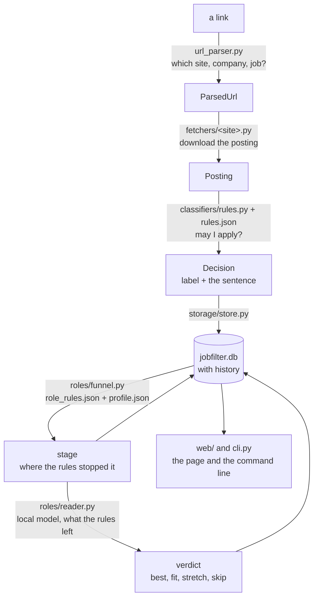
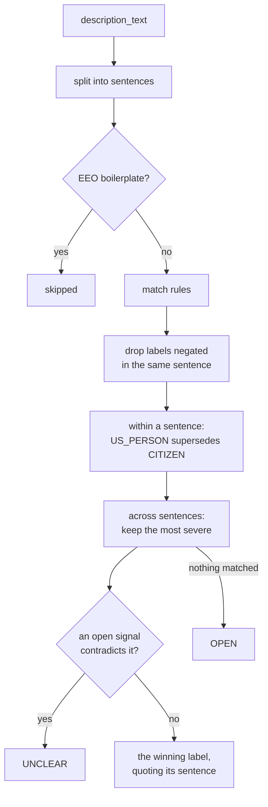

# How jobfilter works

How each part decides what it decides, and why it was built that way. For the steps to
change something, see [EXTENDING.md](EXTENDING.md); for the sites, [SITES.md](SITES.md);
for what is planned, [ROADMAP.md](ROADMAP.md).

- [The pipeline](#the-pipeline)
- [The restriction classifier](#the-restriction-classifier)
- [Sharing the rules with the extension](#sharing-the-rules-with-the-extension)
- [Storage](#storage)
- [Board refresh](#board-refresh)
- [Role screening](#role-screening)
- [Dates: deadlines and posting dates](#dates-deadlines-and-posting-dates)
- [Application tracking](#application-tracking)
- [The web page](#the-web-page)
- [The browser extension](#the-browser-extension)
- [Testing](#testing)

---

## The pipeline



Each step is a module with a small interface (`parse_url(str) -> ParsedUrl`,
`fetch(ParsedUrl) -> Posting`, `classify(Posting) -> Decision`), so a part can be swapped
without rewriting its neighbours. Three ideas run through all of it:

- **Every decision quotes its reason.** A label carries the sentence that caused it, a
  title cut the words, a model fact the sentence it came from.
- **Nothing is dropped.** A link that cannot be parsed or fetched still produces a row
  and a JSONL line with its error, labeled `UNCLEAR` with a `status` of `unsupported` or
  `fetch_error`. Summaries count these under `ERRORS`, apart from genuinely ambiguous
  postings.
- **Meaning and preference are separate files.** `rules.json` and `role_rules.json` say
  what a posting means; `profile.json` says what you want.

---

## The restriction classifier

`RuleClassifier.classify(posting) -> Decision` in
[rules.py](../jobfilter/classifiers/rules.py). A `Decision` holds `label`, `confidence`
(1.0 for rules), `evidence` (the sentence), `matched_rule`, the full `matched_rules` list
and `classifier_name`. `classify_text(str)` runs the same logic on a bare string.

Every pattern lives in [rules.json](../rules.json); none is in Python. Point the
classifier at another file with `--rules`, `JOBFILTER_RULES`, or
`RuleClassifier(RuleSet.load(path))`.

### How a decision is made

1. Split the description into sentences.
2. Skip EEO boilerplate sentences entirely, for rules and for open signals.
3. Match rules per sentence, dropping labels negated in that same sentence.
4. Within a sentence, `RESTRICTED_US_PERSON` supersedes `RESTRICTED_CITIZEN`.
5. Across sentences, keep the most restrictive label by severity.
6. If an open signal contradicts the winner anywhere in the posting, the result is
   `UNCLEAR`.



**Severity** across sentences: `RESTRICTED_CLEARANCE` > `RESTRICTED_CITIZEN` >
`RESTRICTED_US_PERSON` > `UNCLEAR` > `INFO_NO_SPONSORSHIP` > `OPEN`. A clearance is the
narrowest pool; citizen-only is narrower than US-person, which also admits green-card
holders, refugees and asylees.

Supersede and severity pull in opposite directions on purpose. "Must be a U.S.
citizen or lawful permanent resident" matches both rules in *one* sentence, and naming
permanent residents means the posting is not citizen-only, so `US_PERSON` wins. Two
*separate* sentences, one saying "U.S. persons" and one "U.S. citizens only", mean the
narrower one governs, so `CITIZEN` wins.

### rules.json

| Key | Purpose |
| --- | --- |
| `rules` | the patterns, each with an `id`, a `label`, a `note` and an optional `unless` |
| `exclusions` | EEO boilerplate: vetoes a whole sentence |
| `negations` | sentence-local; cancel `applies_to` labels and named `suppresses_rules` |
| `open_signals` | found anywhere; contradicting the winner forces `UNCLEAR` |
| `severity` / `supersedes` | the two precedence mechanisms above |
| `sentence_splitter` | abbreviation patterns that must not be split on |

Two mechanisms exist because of bugs the tests caught:

- **`suppresses_rules`**: negating `RESTRICTED_CLEARANCE` left the bare
  `clearance-mention` rule alive, so "No security clearance required." came back
  `UNCLEAR` instead of `OPEN`. A negation can now also cancel named rule ids.
- **`unless`**: "No visa sponsorship is offered." matched the open signal
  `sponsorship … offered`, faking a self-contradiction. `unless` cancels a pattern when
  the same sentence also matches a second pattern. The same field keeps "clearance
  preferred" and "may require" from reading as requirements.

Patterns use only syntax valid in both Python and JavaScript (no named groups, no
variable-length lookbehind), so the extension loads the same file.

### Sentence splitting

`U.S. citizen` must never split into `U.S.` + `citizen`: that is the exact wording the
tool exists to find. Over-splitting destroys a match; under-splitting only makes a quote
longer, so [sentences.py](../jobfilter/classifiers/sentences.py) is deliberately
conservative. Its abbreviation rule is "a run of single letters each followed by a
period, preceded by a non-letter", which covers `U.S.`, `U.S.C.`, `i.e.`, `e.g.` and
`Ph.D.` without protecting the final `e.` of "experience."

This real sentence holds three traps at once and survives whole:

> In order to comply with the export regulations of the United States Government, it is
> required that the applicant must fall under one of the following categories: (i) U.S.
> citizen or national, (ii) U.S. lawful permanent resident (i.e. current green card
> holder), (iii) Refugee under 8 U.S.C. § 1157, or (iv) Asylee under 8 U.S.C. § 1158.

Evidence is quoted as the posting wrote it: the `- ` bullet marker that the HTML-to-text
step adds is stripped from the quote (the stored description keeps it).

### Judgment calls

These are deliberate, and are the first place to look when a verdict surprises you.
Each has cases in `tests/cases.json`.

- **A bare regulation name is a duty, not a bar.** "Familiarity with ITAR regulations is a
  plus", "Familiarity with FAR, DFARS, ITAR and export compliance requirements" and
  "ensure compliance with export control requirements" are `UNCLEAR`. ITAR or EAR reaches
  `RESTRICTED_US_PERSON` only with requirement wording ("subject to", "must", "eligible",
  "requires"). "U.S. Citizenship or ability to comply with ITAR requirements" is a
  qualification, so it still is.
- **Hedged wording goes to a human.** "This role *may require* access to information
  subject to U.S. export control regulations" is `UNCLEAR`. Calling a conditional
  restriction a bar would make you skip a job you could apply for. Explicit person
  categories still fire regardless ("applicants must be U.S. persons; we may require a
  background check" is `RESTRICTED_US_PERSON`).
- **Preferred is not required.** "TS/SCI clearance desired", "Active Secret clearance is a
  plus" and "clearance … if required by the program" are `UNCLEAR`. A sentence that also
  requires one stays restricted.
- **Eligible for a clearance is a restriction.** "Eligible to obtain and maintain an
  active Secret clearance" names no clearance held today, but clearances are only granted
  to U.S. citizens, so it is `RESTRICTED_CLEARANCE`.
- **Only personnel clearances count.** "creepage and clearance" (PCB), flight, tool and
  customs clearance, and "Public Trust" used as a team name do not.
- **"Authorized to work in the United States" restricts nobody.** Anyone with a work
  permit meets it, so it alone is `OPEN`. With "without the need for current or future
  visa sponsorship" it is `INFO_NO_SPONSORSHIP`. A bare "maintain ongoing work
  authorization" is `UNCLEAR`.
- **An EEO sentence that also states a restriction is `UNCLEAR`**, not vetoed, so nothing
  is silently dropped.
- **An empty description is `UNCLEAR`**, not `OPEN`.

[CHANGELOG.md](CHANGELOG.md) records which rules version introduced each of these and
how many stored labels it moved.

### Re-running rules over stored postings

```bash
jobfilter reclassify --dry-run   # what would change, writes nothing
jobfilter reclassify             # apply it
```

No fetching. A posting gains a history entry only when its verdict (label, quote or rule
list) changes, so the old verdict stays visible.

---

## Sharing the rules with the extension

The extension cannot run Python, so the pipeline is implemented twice:
[extension/src/classifier.js](../extension/src/classifier.js) mirrors
[rules.py](../jobfilter/classifiers/rules.py) and
[sentences.py](../jobfilter/classifiers/sentences.py) step for step. `rules.json` is
genuinely one file; `extension/rules.json` is a copy (a packed extension cannot follow a
symlink), kept byte-identical by `make sync-rules` and a test that fails if they drift.

What stops the two engines drifting is [tests/cases.json](../tests/cases.json): every
label, every gotcha, the hedging cases and real sentences. Both engines run all of it,
and a third test diffs their outputs field by field: label, evidence, matched rule, rule
list, confidence.

```
tests/cases.json ──> Python RuleClassifier ─┐
                 └─> JavaScript engine ─────┴─> must be identical
```

**Add a case to `cases.json`, not to one language's tests.** The Python half runs in
`test_rule_classifier.py`; the JavaScript half and the diff in `test_js_parity.py`.

JavaScript runs in headless Chrome, with no Node needed. V8 is the engine the extension
actually runs in, so it is the faithful target anyway.
[tests/jsrunner.py](../tests/jsrunner.py) builds a self-contained HTML harness (script and
data inlined, so `file://` CORS never arises), runs it under `--headless --dump-dom`, and
reads a JSON result back. Without Chrome the JS tests skip and the Python ones still run.

---

## Storage

Every `check` is recorded in SQLite (`./jobfilter.db`, or `$JOBFILTER_DB`, or `--db`;
`--no-db` opts out). The CLI, the web page and the extension all write to the same
store, so anything checked one way shows up in the others.

SQLite fits a single-user local tool: it is in the standard library, is one file you
can copy or delete, needs no daemon, and answers ad-hoc questions at a `sqlite3
jobfilter.db` prompt. Postgres would be the target if this ever went multi-user.

### Tables

[schema.sql](../jobfilter/storage/schema.sql) always describes the newest shape.

| Table | Holds |
| --- | --- |
| `companies` | one row per (platform, slug), with a display name |
| `postings` | one row per (company, job): text, raw JSON, `content_hash`, location, `posted_on`, `apply_by`, `closed_at`, LinkedIn listing signals |
| `classifications` | append-only verdict history per posting and classifier |
| `runs`, `run_items` | every run and every link in it, including failures, with `origin` |
| `posting_changes`, `board_refreshes` | what each board refresh found |
| `role_screens`, `role_facts` | where the role funnel stopped each posting; the model's latest reading |
| `applications`, `application_events`, `resumes` | your marks and notes, steps reached, uploaded resumes |

Two views: `latest_classifications` (newest per posting per classifier) and
`posting_overview` (everything one row of the page needs).

Decisions that shape it:

- **Classifications are history, not a column.** Re-checking a posting appends a row only
  when the verdict changed, so the table is a change log rather than a pile of
  duplicates.
- **`content_hash`** (sha256 of the description) tells "the company edited this posting"
  from "nothing happened".
- **`classifier_name` is part of the history key**, so a future model classifier can
  store its verdict next to the rule verdict on the same posting.
- **Three kinds of data.** *Yours* (`applications`, `application_events`, `resumes`):
  nothing rewrites it but you. *Fetched* (`postings`, `classifications`): kept as history,
  never deleted by a refresh. *Derived* (`role_screens`): rebuilt whole by `screen`.
- **Migrations are stepwise.** A fresh database gets `schema.sql` directly; an existing
  one applies each entry of `MIGRATIONS` in [store.py](../jobfilter/storage/store.py)
  above its own `user_version`, and upgrades in place on first open. Tests build old
  versions and check the data survives. Back up first: `cp jobfilter.db
  jobfilter.db.bak-$(date +%F)` with the server stopped.

### Reading it

```python
from jobfilter.storage import Store

with Store("jobfilter.db") as store:
    store.stats()                                   # totals by label
    store.postings(label="RESTRICTED_US_PERSON")    # filter by label
    store.postings(company="graymatter-robotics")
    store.postings(query="citizen")                 # title / company / evidence
    store.company_summary()                         # per-company counts
    store.posting(1)                                # detail + full history
    store.failures()                                # what never classified
```

```bash
sqlite3 jobfilter.db "SELECT company_slug, label, title FROM posting_overview WHERE label LIKE 'RESTRICTED%';"
```

### JSONL output

`check --out results.jsonl` writes one flat object per link: `url`, `status`, `origin`,
`platform`, `company_slug`, `job_id`, `title`, `location`, `label`, `confidence`,
`evidence`, `matched_rule`, `matched_rules`, `classifier_name`, `error`, `error_type`.

```bash
jq -r 'select(.label | startswith("RESTRICTED")) | [.company_slug, .title] | @tsv' results.jsonl
jq -r 'select(.label == "UNCLEAR" and .status == "ok") | .url' results.jsonl     # needs review
jq -r '.matched_rules[]?' results.jsonl | sort | uniq -c | sort -rn               # rules that fired most
```

---

## Board refresh

`check --expand` finds a company's jobs once. `jobfilter refresh` goes back to every stored
company whose site can list a board, and reports what is different:

| Change | Meaning |
| --- | --- |
| `new` | the board lists a job that was not stored |
| `edited` | a stored job's description changed (`content_hash` differs) |
| `relabeled` | its verdict changed, recorded as `OPEN -> RESTRICTED_US_PERSON` |
| `closed` | the board no longer lists a stored job |
| `reopened` | a closed job is listed again |

- **Nothing is deleted.** A job that left its board keeps its row, text and history and
  gets `postings.closed_at`. A later successful fetch clears it.
- **Quick by default.** Ashby, Greenhouse, Lever and Workable return a whole board with
  its text in one request, so they are always read in full and edits are caught for free.
  On the per-job sites (Workday, Rippling, Dover, SmartRecruiters, Eightfold) a quick
  refresh *lists* the board and fetches only jobs it does not hold: that finds new and
  closed jobs but not edits. `--deep` reads every job.
- **A board that cannot be read closes nothing.** It is reported as failed; only a listing
  that actually arrived can say a job is gone.
- **Some boards are found from a stored job.** A Workday board lives at a host and site
  name, a Dover one under a client id; neither is in the slug. The refresh shows the
  fetcher the stored job links first (`BoardLearner.learn`).
- LinkedIn, Indeed and "any page" postings have no board and are left alone.

Caveats: "closed" means "not in the listing this time" (a Workday board over the 2,000-job
cap that cannot be split fully lists fewer jobs than exist). Change tags describe each
company's *latest* refresh, so a second refresh that finds nothing clears them; `closed`
is a state and stays.

On the web page, **Companies → Refresh boards** runs the same thing on a background
thread ([refresh_job.py](../jobfilter/web/refresh_job.py)), one at a time, and each
company row has its own ↻.

---

## Role screening

The restriction check answers "may I apply?". Role screening answers "is it my kind of
role?", driven by your `profile.json`. It is optional and separate: it never touches the
restriction rules.

### Step 1: the rule funnel

[roles/funnel.py](../jobfilter/roles/funnel.py). A posting stops at the first stage that
removes it:

| Stage | Decided by | Removes |
|---|---|---|
| `location` | [location.py](../jobfilter/location.py) | places outside the profile's `locations` |
| `restricted` | the restriction label | labels the profile does not keep |
| `non_engineering` | title | HR, finance, legal, sales, supply chain, technician, admin |
| `seniority` | title | manager, staff / principal, intern, PhD (senior is optional) |
| `off_focus` | title, description, company | postings not about the profile's `focus` |
| `mech_elec` | title | mechanical, electrical, chip design, manufacturing |
| `model` | — | nothing: these are what the model reads next |

[role_rules.json](../role_rules.json) says what a title **means**; `profile.json` says
what **you** skip. With `"focus": []` every engineering role passes that stage.

A title is read in parts: `Senior Thermal Engineer, Expeditionary AI` is the role
`Senior Thermal Engineer` and the team `Expeditionary AI`. A rule's exception ("not HR if
it says engineer") is checked against the matching part and the role part, never the
whole title. So `AI Solutions Engineer, Talent Acquisition` is not HR, `Software
Engineer, Manufacturing Test` is not manufacturing, and the thermal engineer is still
mechanical.

**Focus** is decided by the title, or by the description when at least `min_sentences`
separate sentences mention a focus term. Counting sentences matters: a company blurb that
lists "autonomy, computer vision, sensor fusion" in one sentence on every posting must not
make every role in focus. A company where at least half the postings are in focus counts
as a focus company, which rescues a two-line posting there.

```bash
jobfilter screen                                  # store where every posting stops
python -m jobfilter.roles                         # counts per stage
python -m jobfilter.roles --show off_focus -n 40  # examples a stage removed, and why
```

### Step 2: a local model reads what is left

[roles/reader.py](../jobfilter/roles/reader.py) sends what passed the rules to a model
under Ollama on your machine (default `qwen2.5:7b`, about 2 s per posting on an 8 GB GPU).
Nothing leaves the machine.

The model only reports facts, and code turns them into a verdict. Asked "should this candidate
apply?", a 7B model was wrong on two of five obvious fits (it read "MS or PhD" as
PhD-required). Asked only for facts it can quote, it was right. So it is asked for:

- `core_work`: one of a fixed set of categories (`CORE_WORK`);
- `years_required` with its sentence, for *your* degree when the posting gives a ladder
  ("BS and 5+ years or MS with 2+");
- `degrees_accepted` with its sentence ("MS or PhD" is both);
- `student_only`.

Nothing is taken on trust. A quote must be in the posting or its fact is dropped. A years
figure must be in its quote or the posting; one that is in neither is dropped and the
verdict becomes **needs a look**, never a fit by default.

`judge` then applies the profile's `fit` section:

| Verdict | When |
|---|---|
| **Fit** | work in `want`, at most `max_years`, no degree above yours required |
| **Stretch** | work in `stretch`, or more than `max_years` up to `stretch_years` |
| **Skip** | any other work, more than `stretch_years`, or a higher degree required |
| **Needs a look** | the model failed, or a years figure could not be checked |

Readings are stored as they land, so a stopped run loses nothing; only unread postings
are read, and a posting is read again when its description changes or `PROMPT_VERSION`
rises. Editing `profile.json` and running `jobfilter screen` re-judges every stored reading
in seconds without calling the model.

### Step 3: skill match and "best fit"

The profile's `skills` list is name, regex and weight. A posting's match score is the sum
of the weights it mentions, each skill counted once however often it appears
([match.py](../jobfilter/roles/match.py)). A **fit** scoring at least `best_fit_score`
becomes a **best fit**. The Inbox lists best fits first, then fits, stretches and the
rest, higher scores first within each.

### Running it automatically

After **Add jobs → Check** and after a board refresh, the page starts a background job
([process_job.py](../jobfilter/web/process_job.py)) that screens every posting and has
the model read whatever passed and is unread. A bar at the top shows progress; when
postings are waiting and nothing runs, it offers **Screen and read**. If Ollama is down
the bar says so and nothing is lost. On the command line, `jobfilter read` screens,
reads, and screens again.

---

## Dates: deadlines and posting dates

**Apply-by dates.** [deadline.py](../jobfilter/deadline.py) reads a deadline out of the
description on every site ("accepted at least until October 4, 2026", "Application
deadline: Oct 12", "Posting Dates: Oct 2 - Oct 10"): the date, the sentence, and whether
it is firm. "At least until" is a minimum. Failing that it uses Workday's `endDate`, the
day before which counts as the last day. A posting is **closing soon** when it is open
and its date is within `CLOSING_SOON_DAYS` (7, in
[store.py](../jobfilter/storage/store.py)) ahead, or a minimum within 7 days behind:
postings stated as "at least until" were seen to come down within days of that date. A
phrasing not seen yet is missed silently; add it to `_LEAD` with a test.

**Posting dates.** [posted.py](../jobfilter/posted.py) reads each board's own date field
(table in [SITES.md](SITES.md#posting-dates)), stored as `postings.posted_on`.

---

## Application tracking

A posting marked **Applied** takes steps (**OA**, **Interview**, **Offer**, **Rejected**),
each kept with the date you pressed it, so a rejection after an interview still shows the
interview. It also takes the resume you sent (PDF or DOCX, up to 5 MB). A resume is its
contents, not its name: uploading the same file again reuses the stored one, so the
applications it went to count together. Files live inside `jobfilter.db`, so a copy of
the database carries them. Clearing an Applied mark forgets its steps and detaches its
resume (the file is kept); the page asks first.

The **Applications** page lists every applied posting with where it stands (an offer,
else a rejection, else the furthest step, else waiting), and per resume how many
applications reached each step. Steps are counted as *reached*, so one rejected after an
interview is in both columns: that is what tells you a resume gets interviews.

---

## The web page

`jobfilter serve` runs a standard-library `http.server` on `127.0.0.1:8000` with one
static page ([web/static/](../jobfilter/web/static/)). No framework and no build step:
edit the files and reload. Endpoints are listed in [HTTP-API.md](HTTP-API.md).

Pages (each a URL, `/#explore`): **Inbox**, **Applications**, **Calendar**, **Explore**,
**Companies**, **Add jobs**. [USAGE.md](../USAGE.md#the-web-page) describes them from the
user's side.

Design notes:

- **Color never carries meaning alone.** Every label badge is a coloured dot plus its
  text, and the text stays in primary ink.
- **Failures show their status, not a label.** A row in "Could not be checked" reads
  `unsupported` or `fetch_error`.
- **`Store` is thread-safe.** `ThreadingHTTPServer` serves each request on its own
  thread and a SQLite connection is bound to its creating thread, so the store holds one
  connection behind a reentrant lock. (A thread-local connection would have been wrong:
  each thread would get its own empty `:memory:` database in tests.)
- **Static serving cannot escape `web/static/`**, encoded traversal included.
- **Filters are SQL; regions are Python.** [location.py](../jobfilter/location.py) splits a
  location on `;` (and comma lists of bare cities) and places each part by its strongest
  signal: an explicit country, a foreign country, a US state name or `, TX` code, a
  well-known foreign city, then a US city from
  [us_cities.tsv](../jobfilter/us_cities.tsv) (GeoNames places of 1,000+ people, built by
  [build_us_cities.py](../scripts/build_us_cities.py)). So "Melbourne, Florida" is US and
  a bare "Melbourne" is not. The store registers this as SQLite functions
  (`jf_in_region`, `jf_place_matches`), so paging and counts stay in one query and a typed
  "USA" and the **United States** checkbox can never disagree.
- **The Companies table follows Explore's filters**, but every company stays listed (at
  zero if nothing matches) and hide / only do not apply, so a hidden company can still be
  refreshed.
- **Company filters match the slug.** The same company on two platforms has two slugs and
  needs hiding twice.

---

## The browser extension

A Chrome Manifest V3 extension in [extension/](../extension/) that reads the posting you
are looking at, classifies it with the same `rules.json`, and shows the verdict and its
sentence in a badge.

| Where | How the posting is found |
| --- | --- |
| LinkedIn `/jobs/view/{id}` and search results (`?currentJobId=`) | site selectors → JSON-LD → the "About the job" heading |
| Indeed `/viewjob?jk=` and search results (`?vjk=`) | site selectors → JSON-LD → the "Job description" heading |
| Workday `*.myworkdayjobs.com` job pages and the search pane | `data-automation-id` hooks scoped to the open posting → JSON-LD naming the same job |
| any other page, on request | JSON-LD `JobPosting` → the largest description-like block → `<body>` |

These sites swap postings without a page load, so the content script watches the page
(debounced) and re-checks whenever the posting's id or text changes. A job page whose
description cannot be found shows **"Couldn't read this posting"**, never a blank badge
that would look like "no restriction". On Workday the company is the tenant in the
hostname, and a page whose requisition id does not yet match the URL's is skipped until
it catches up. Only `*.myworkdayjobs.com` is matched; other Workday domains need **Scan
this page**.

By default the verdict comes from the bundled JS engine, instant and offline.
In **Local server** mode it shows the local verdict, then the server's
(`POST /api/classify`), and says when they disagree or when the server is down. The
server runs whatever classifier it was started with, so a future model classifier
reaches the extension with no extension change. **Save postings I view** sends each
posting to `POST /api/browsed`, which classifies server-side and stores it with origin
`browsed`. LinkedIn's "Reposted 2 weeks ago · Over 100 applicants" line is stored too,
with the time it was read.

Security choices:

- **Only localhost.** `host_permissions` is `127.0.0.1` and `localhost`, and the engine
  refuses any other server URL, so a mistyped setting cannot send postings elsewhere.
- **No CORS on the server.** The service worker reaches it through host permissions,
  which skip CORS. An ordinary website cannot: its JSON POST needs a preflight the server
  never answers, so a page you visit cannot read or write your database. A test pins this
  down.
- **Page text is data.** Badge and popup set every string with `textContent`, inside a
  shadow root. A test feeds the badge `` as evidence.
- **Narrow permissions:** `storage`, `activeTab`, `scripting`. **Scan this page** works
  through `activeTab`, so the extension cannot read arbitrary sites on its own.

### When a site changes its page

The Workday fixtures are real pages. **The LinkedIn and Indeed fixtures are hand-built**
from those sites' known structure, with the clutter real pages have (job lists, buttons,
inline scripts); the JSON-LD and heading fallbacks guard against a redesign, but the
selectors are only as current as that structure.

When a badge says "Couldn't read this posting": open the extension popup → **Developer →
Download page HTML**, scrub your name, profile and messages from the file, and replace the
matching fixture in [tests/fixtures/extension/](../tests/fixtures/extension/) (its
README explains). The failing test then names the selector to fix:

```
linkedin_job_view.html: description came from '.jobs-description__content .jobs-box__html-content',
expected '#job-details'. If the site changed its markup, the selectors tried were: ...
```

### Extension tests

| Layer | File | Runs against |
| --- | --- | --- |
| extraction | `test_extension.py` | saved pages in `tests/fixtures/extension/` |
| HTML → text parity | `test_extension.py` | real Greenhouse / Lever / Ashby markup, Python vs JS |
| engine, worker, badge, content script | `test_extension.py` | a fake `fetch` and a fake `chrome` |
| end to end | `test_extension_e2e.py` | the unpacked extension in headless Chrome |
| server endpoints | `test_extension_api.py` | the real server |

Branded Chrome dropped `--load-extension` in version 137, but the DevTools protocol's
`Extensions.loadUnpacked` still works over `--remote-debugging-pipe`.
[tests/cdp.py](../tests/cdp.py) loads the real extension that way, intercepts requests to
LinkedIn / Indeed and answers with the fixture pages, then reads the badge out of the
page. No network, a few seconds.

---

## Testing

```bash
make test          # everything offline
make test-live     # @pytest.mark.live: real sites, and Ollama for test_reader.py
```

- **Offline by default.** `-m 'not live'` is set in `pyproject.toml`. No test calls the
  network, a model or your database; `tests/conftest.py` points every test at
  `profile.example.json`, never your `profile.json`.
- **Saved real responses.** Fetcher tests serve files from `tests/fixtures/` through
  `httpx.MockTransport`. Live tests re-fetch the same postings and assert their shape, to
  catch an API drifting.
- **Real Chrome where it matters.** The JS engine, the extension and the web page
  (`tests/test_web_ui*.py`) run in headless Chrome and skip without it. One web test
  answers 16 concurrent requests across 8 threads on a real port: the test that catches
  the SQLite threading trap.
- **Tests that can fail.** The parity and extension tests were checked by deliberately
  breaking the code. Disabling US_PERSON-supersedes-CITIZEN in the JS engine fails 4 named
  cases; renaming LinkedIn's `#job-details` selector fails 2 fixture tests listing the
  selectors tried; rendering evidence with `innerHTML` fails the XSS test; returning
  `OPEN` when the server fails fails 3 fallback tests. A leak test first missed that
  "…see more" button text inside the description could leak into it, because no fixture
  had a button inside the description; one now does.

Running one area:

```bash
.venv/bin/python -E -m pytest tests/test_rule_classifier.py tests/test_js_parity.py -q   # rules, both engines
.venv/bin/python -E -m pytest tests/test_url_parser.py tests/test_fetchers.py -q          # links and fetchers
.venv/bin/python -E -m pytest tests/test_storage.py tests/test_refresh.py -q              # database and refresh
.venv/bin/python -E -m pytest tests/test_roles.py tests/test_reader.py tests/test_match.py -q
.venv/bin/python -E -m pytest tests/test_web.py tests/test_web_ui.py -q
```
