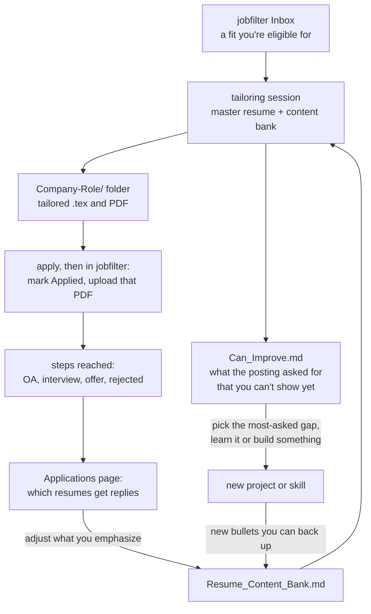

# Tailoring resumes alongside jobfilter

jobfilter tells you which postings are worth applying to. The other half of a job search
is sending a resume that fits each one, and learning from what postings keep asking for
that you can't show yet. This page describes how the author does that with a separate,
private resume repository and an AI coding assistant, so you can set up something
similar. jobfilter doesn't depend on any of it.

- [The resume repository](#the-resume-repository)
- [A tailoring session](#a-tailoring-session)
- [Getting better between applications](#getting-better-between-applications)
- [Setting up your own](#setting-up-your-own)



---

## The resume repository

It is a plain folder kept under version control, private because it holds contact
details and answers about work authorization. The resume itself is LaTeX, so every
version is text that diffs cleanly and builds to the same PDF every time.

```
resume/
  Base-Master_Resume/           the master resume: layout, header, fixed sections
  Company-Role/                 one folder per application
    company_role.tex            the tailored resume
    Firstname_Lastname_….pdf    the exact PDF you uploaded
    cover_letter.tex            only when one was asked for
  …                             (one folder for each application)
  Archive/                      older versions, kept for reference
  docs/
    Resume_Content_Bank.md      every bullet, project and skills line, with variants
    Application_Answers.md      answers to application-form questions, reusable and per company
    Can_Improve.md              what postings asked for that the resume couldn't show
```

What each part is for:

- The master resume holds what never changes between versions: the header, education,
  layout and section order. A tailored resume starts as a copy of it.
- The content bank is where the wording lives. Each job and project has its bullets
  written several ways, one per emphasis (simulation, planning, perception, testing),
  together with a short index of which variant went into which application. A "do not
  reuse" section collects outdated or inaccurate phrasings that still sit in old files,
  so they don't get copied forward.
- Naming folders `Company-Role` keeps them sorted by company and matches how jobfilter
  lists a posting, so finding the resume for an application, or the application for a
  resume, takes a second.
- The PDF in each folder is the file you actually sent. When an interview comes, you
  prepare from what the company read, not from today's master.
- The answers file saves rewriting "Why this company?", "What are you proudest of?" and
  the work-authorization questions on every portal. Reusable answers sit at the top and
  company-specific ones below.
- The gap log is described [below](#getting-better-between-applications).

---

## A tailoring session

One session covers one posting. It runs in an AI coding assistant (the author uses
Claude Code) opened in the resume repository.

1. Choose the posting in jobfilter. The Inbox lists fits first and shows which of your
   skills the posting mentions and why the model judged it a fit. The restriction label
   tells you whether you're eligible at all, so no time goes into tailoring for a job
   that requires a clearance you can't get.
2. Give the assistant the posting: the full text from the posting's details, plus the
   company and title.
3. The assistant drafts from the bank. It copies the master into a new
   `Company-Role/` folder and fills it with the bank variants that match the posting's own
   wording, reorders sections so the most relevant work comes first, and adjusts the
   skills line. It only uses what the bank contains: the bank is the record of what you
   have actually done, so nothing gets made up to match a keyword.
4. Build and check. Compile the PDF, then check that it is one page, has no layout
   warnings, and that every claim still holds when you read it cold.
5. Log the gaps. Anything the posting asks for that the bank can't back up goes into
   `Can_Improve.md` under its area. If it is already listed, its count goes up instead.
6. Apply, then record it. In jobfilter, mark the posting **Applied** and attach the
   same PDF with **Upload…**, so the Applications page knows which version went where.
7. Answer the form. Reuse answers from `Application_Answers.md`, and add any new
   question you had to answer, so the next form is faster.

A standing instruction for the assistant (in its memory, or a `CLAUDE.md` in the resume
repo) keeps sessions consistent: always work from the bank, never invent experience,
always log gaps, and keep the uploaded PDF next to its source.

---

## Getting better between applications

After a few dozen postings, `Can_Improve.md` shows what your target roles expect. It is
grouped by area (simulation, machine learning and perception, planning and controls,
software and hardware, testing and infrastructure), with an "asked for most often" list
at the top and notes on portfolio fixes and experience level.

Between applications, that list decides what to work on next:

- Take the gap at the top of "asked for most often" that you can close in a week or two,
  and close it with something you can show: a small project, a contribution, a write-up.
- When it is done, write it into the content bank, in a couple of variants. From then on
  every tailored resume can claim it truthfully.
- Fix portfolio problems the log mentions (an unclear project page, a missing demo
  video), since reviewers follow those links.

jobfilter's **Applications** page gives the other signal: for each uploaded resume, how
many applications reached an OA, an interview or an offer, and how many got any reply. If
the versions that emphasize one area keep getting replies and another emphasis never
does, that tells you which variants to lead with, and whether some kinds of role are a
better match than you assumed.

---

## Setting up your own

1. Make a private repository with a master resume in LaTeX (or any text-based format) and
   the three files under `docs/`. Start the content bank by pasting in every bullet you
   have ever written, then group them by job and project.
2. Write the standing instructions for your assistant: where the bank is, how folders are
   named, that the gap log is updated every session, and that nothing outside the bank is
   claimed.
3. In jobfilter, copy `profile.example.json` to `profile.json` and list your skills there
   with weights ([EXTENDING.md § 1](EXTENDING.md#1-change-your-preferences-profilejson)).
   The Inbox then puts the postings that name your skills first, which are the ones worth
   tailoring for.
4. Keep the two repositories separate. jobfilter is shareable; the resume repo holds your
   contact details, work-authorization answers and application history, and should stay
   private.

Ideas for connecting the two more closely are in
[ROADMAP.md](ROADMAP.md#resumes-and-skill-gaps).
