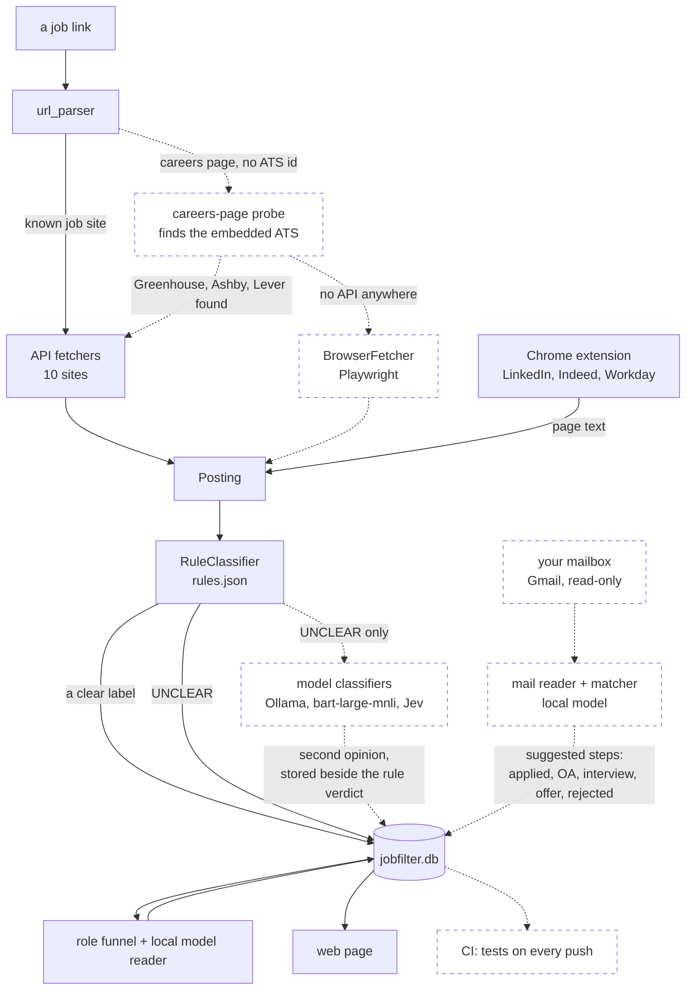
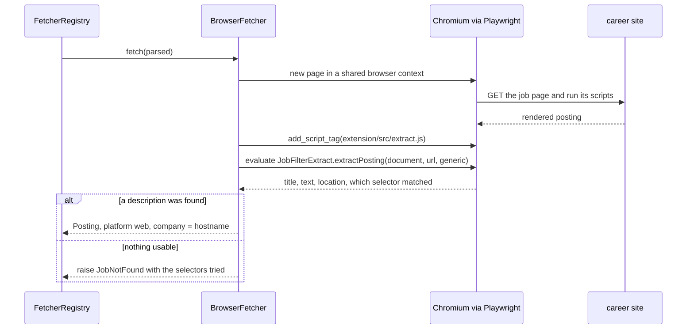
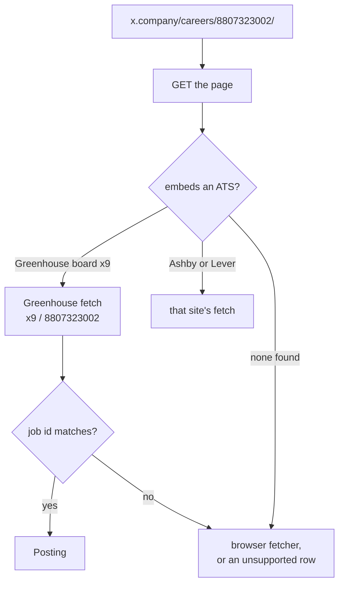
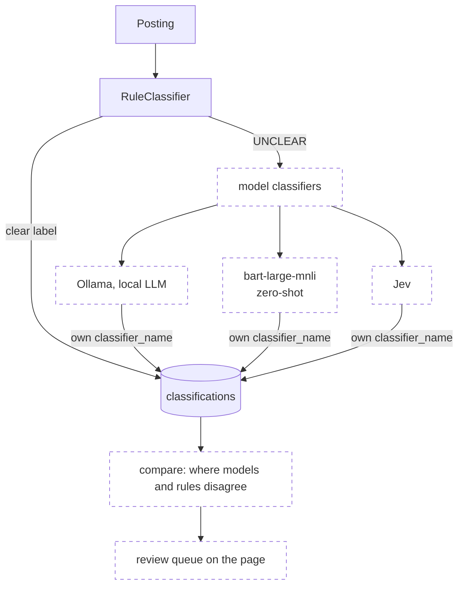
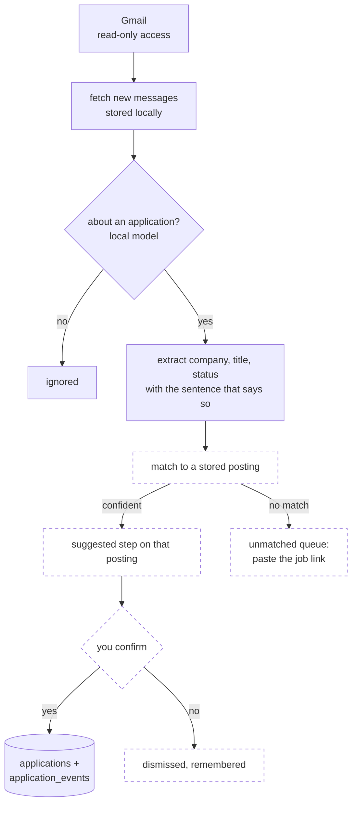
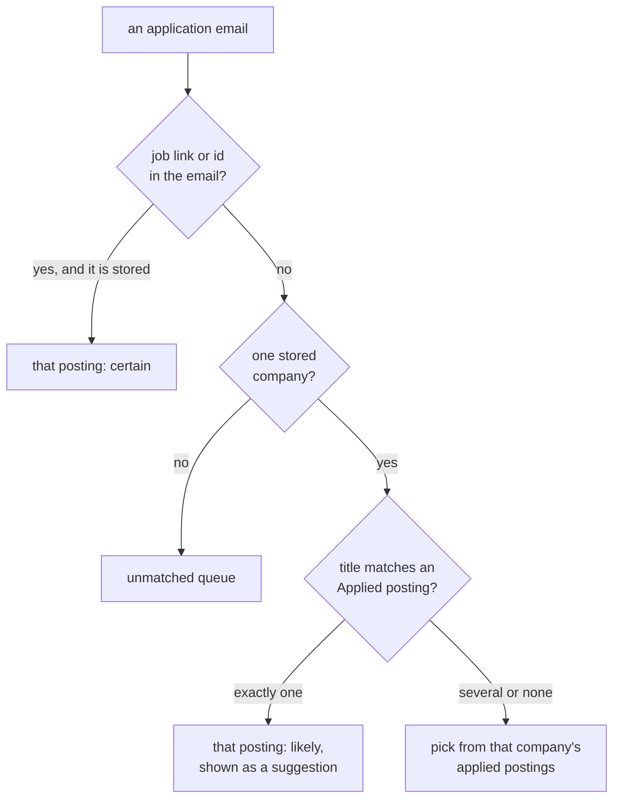

# Roadmap

What is planned, what has been designed, and where each piece plugs in. Nothing on this
page is built yet unless it says so. To pick something up, read the section, then follow
the matching guide in [EXTENDING.md](EXTENDING.md).

- [Where things stand](#where-things-stand)
- [Reading more career sites](#reading-more-career-sites)
  - [A browser fetcher (Playwright)](#a-browser-fetcher-playwright)
  - [A careers-page probe](#a-careers-page-probe)
  - [More link shapes and platforms](#more-link-shapes-and-platforms)
- [Better decisions on UNCLEAR postings](#better-decisions-on-unclear-postings)
- [The browser extension](#the-browser-extension)
- [Application emails](#application-emails)
- [Resumes and skill gaps](#resumes-and-skill-gaps)
- [Refresh, screening and tracking](#refresh-screening-and-tracking)
- [The project itself](#the-project-itself)

---

## Where things stand

Solid boxes exist today; dashed boxes are planned.

| Area | Item | Status |
| --- | --- | --- |
| Sites | Browser fetcher for career pages with no public API | designed, below |
| Sites | Careers-page probe (links like `x.company/careers/{id}`) | designed, below |
| Sites | Board links and API links for Ashby, Greenhouse, Lever | small, open |
| Sites | More platforms (Breezy, Zoho Recruit, Phenom, …) | candidates |
| Decisions | Model classifiers on `UNCLEAR` postings, compared with the rules | interfaces ready |
| Decisions | An evaluation set from hand-labeled job lists | open |
| Extension | Real LinkedIn / Indeed fixtures; Firefox build; marks and deadlines on the badge | open |
| Tracking | Application emails: steps filled in from your mailbox (JobTracker prototype) | designed, below |
| Tracking | Resumes and skill gaps: a gap report from postings, resume versions linked to applications | open |
| Tracking | "Changes since" cutoff, scheduled refresh, editable step dates, resume groups | open |
| Project | CI with a live tests badge | open |

---

## Reading more career sites

Every site jobfilter reads today has public JSON behind its pages. Two kinds of link are
still left out: a company's own careers page that hides which ATS it uses, and a careers
site with no JSON at all. The probe handles the first cheaply; the browser fetcher handles
the second.

### A browser fetcher (Playwright)

Some career sites build their job pages in JavaScript from data you can't get as plain
JSON, or only from endpoints that change with every deploy. For those, loading the page
in a real browser is the only dependable way to read it. Workday was the original reason
for planning this, but it turned out to have a usable JSON API
([SITES.md](SITES.md#workday)).

The browser fetcher would be one more `Fetcher` (`fetch(parsed) -> Posting`) registered in
[registry.py](../jobfilter/fetchers/registry.py); the registry's docstring already
mentions it. Nothing downstream would change, since the classifier, storage and page only
ever see a `Posting`. Postings go under `Platform.WEB`, which the extension already uses
for pages it reads, with the hostname as the company.

Most of the hard part already exists. [extract.js](../extension/src/extract.js), the
extension's page reader, tries JSON-LD `JobPosting`, then site selectors, then the largest
description-like block, and records which selector produced each field. It only touches
the DOM and is exposed as `globalThis.JobFilterExtract`, so the browser fetcher can inject
the same file into the page and call it. That keeps a single extractor, and its existing
tests cover both uses.

Things to get right when building it:

- Keep Playwright optional. The core needs only `httpx`; Playwright would go in an extra
  (`pip install -e '.[browser]'`, then `playwright install chromium`). Without it, these
  links stay visible as unsupported rows instead of failing.
- Use it last. `url_parser` keeps returning `unsupported` for unknown links. The registry
  tries the careers-page probe first and the browser after that, and only for links
  someone pasted, never for a whole board.
- Go slowly: one page at a time per host with the same pacing the Eightfold fetcher uses,
  and no logins or pages behind a sign-in.
- Start with single jobs. A site that needs whole-company scans deserves a real API
  fetcher instead.
- While a page loads, Playwright sees every JSON response the site fetches. Logging the
  ones that contain the description would show which endpoint an API fetcher should
  call, which shortcuts the network-inspection step in
  [EXTENDING.md § 6](EXTENDING.md#6-add-a-job-site-amazon-jobs-step-by-step).
- Test offline by serving saved HTML through Playwright's request routing, as
  [tests/cdp.py](../tests/cdp.py) already does for the extension, and skip the tests when
  Playwright isn't installed.

### A careers-page probe

`https://x.company/careers/8807323002/` is a Greenhouse job on board `x9`, but nothing in
the link says so. Today it comes back `unsupported` until you add `?gh_jid=8807323002`
yourself ([SITES.md](SITES.md#links-that-do-not-work-and-what-to-do)).

The probe would download the page once with `httpx` and look for the job board it embeds.
A Greenhouse embed script or board link names the board (`for=x9`), an Ashby embed names
its slug, and a Lever link names the company. Once the board is known and the path has a
job id, the link can be fetched like any Greenhouse, Ashby or Lever job. The Ashby fetcher
already does a version of this for `?ashby_jid=` links
([SITES.md](SITES.md#slug-lookups-for-company-careers-pages)).

Like the Ashby lookup, a guess is accepted only once the board actually lists the job, so
a wrong match costs a 404, never a wrong posting.

### More link shapes and platforms

- **API links for Greenhouse, Lever and Ashby**, such as
  `boards-api.greenhouse.io/v1/boards/x9/jobs/8807323002`: a few lines in
  [url_parser.py](../jobfilter/url_parser.py) and table rows in its tests.
- **Board links for the same three** (`jobs.lever.co/acme`). Each already has a board
  fetcher; only the parser and `fetch_board_url` are missing.
- **Workday on other domains** (`myworkdaysite.com`, custom domains): the extension only
  matches `*.myworkdayjobs.com` today.
- **New platforms seen in the wild**: Breezy HR, Zoho Recruit and Phenom-hosted career
  sites. None has been checked yet; each starts with the network inspection in
  [EXTENDING.md § 6](EXTENDING.md#step-1-find-where-the-site-keeps-its-data).

---

## Better decisions on UNCLEAR postings

The rules are deliberately cautious: anything ambiguous is `UNCLEAR`, for a human to
read. The plan is a second opinion on just those postings, never a replacement for the
rules.

The interfaces are ready for this:

- A model classifier implements the same `Classifier` protocol
  ([classifiers/base.py](../jobfilter/classifiers/base.py)) and returns a `Decision`;
  `confidence` is a float for this reason.
- `classifier_name` is part of the history key in `classifications`, so a model's verdict
  is stored next to the rule verdict on the same posting, not over it.
- The extension's **Local server** mode asks the server, which runs whatever classifier it
  was started with, so a model reaches the extension with no extension change.

Two limits on any model: it must quote the sentence it relied on, and that quote must be
in the posting (the role reader already checks this). And it never overrides a rule's
`RESTRICTED_*` with `OPEN`; it only helps sort the `UNCLEAR` pile.

To measure all this, the SimplifyJobs lists mark postings 🇺🇸 "Requires U.S.
Citizenship" and 🛂 "Does NOT offer sponsorship" by hand
([README](../README.md#related-projects)). Fetching the linked postings and comparing
jobfilter's labels with those marks would measure the rules, and later each model, on
data nobody here labeled.

Also open: deadline and restriction phrasings not seen yet are missed silently. Each new
one needs a line in `tests/cases.json` (or `_LEAD` in `deadline.py`) and a rule.

---

## The browser extension

- **Real LinkedIn and Indeed fixtures.** Today's are hand-built from those sites' page
  structure; scrubbed real pages would catch selector drift sooner
  ([HOW-IT-WORKS.md](HOW-IT-WORKS.md#when-a-site-changes-its-page)).
- **Applied / Maybe / Skip on the badge**, through the existing
  `POST /api/postings/{id}/application`, and the apply-by date beside the verdict.
- **A Firefox build.** The Manifest V3 differences are small:
  `browser_specific_settings` and background scripts in place of a service worker.

---

## Application emails

jobfilter knows which postings you applied to, but every later step (online assessment,
interview, offer, rejection) is a button you have to remember to press, even though the
company already told you by email.

JobTracker, a separate private project by the same author, already handles the email
side. It pulls messages from Gmail with read-only access into a local
SQLite file, has a local model (llama3 through Ollama) decide which emails are about an
application, extracts the company, the job title and a status (`applied`, `assessment`,
`interview`, `offer`, `accepted`, `rejected`), and shows them on a small page for manual
correction. What it lacks is the link to a posting: it knows "an interview at Acme", not
*which* Acme job. jobfilter has the postings and the steps, so joining the two would let
each application's record run from the first check through to the final reply.

Solid boxes below exist in JobTracker today; dashed ones are the new work.

JobTracker's statuses already fit jobfilter's steps:

| Email status | jobfilter |
| --- | --- |
| `applied` | mark **Applied**, dated when the confirmation arrived |
| `assessment` | step **OA** |
| `interview` | step **Interview** |
| `offer`, `accepted` | step **Offer** |
| `rejected` | step **Rejected** |

Matching an email to a posting goes from the most certain evidence to the least, and
stops at the first that answers: a job link or id in the email (`gh_jid`, a Workday req id, a Lever or
Ashby URL), then the sender or company name against stored companies, then the title
against that company's postings you marked Applied.

ATS confirmation emails often carry the job's own link, and a link is parsed by the same
[url_parser](../jobfilter/url_parser.py) that reads pasted links, so the top rung is
usually enough. The ATS sending domains (Greenhouse, Lever, Ashby, Workday) also tell
which platform a company uses.

Things to get right when building it:

- Email never changes your marks on its own. `applications` and `application_events` are
  only ever changed by you ([HOW-IT-WORKS.md](HOW-IT-WORKS.md#storage)), so steps found in
  email are stored as suggestions next to the email they came from. You accept them one
  at a time, or all at once for the certain matches.
- The model quotes the sentence that gives the status ("we would like to invite you to an
  interview"), and the quote has to be in the email; otherwise the suggestion is marked
  "needs a look", as the role reader does.
- A step is dated by when the email arrived, not when you clicked, which also takes care
  of the "set a step's date yourself" item further down.
- Gmail access stays `gmail.readonly`. OAuth files and tokens go in `~/.config/jobfilter/`,
  never in the repository, and only what matching needs (sender, subject, date, the start
  of the body) is kept, in `jobfilter.db`.
- The Google libraries are an optional extra (`.[mail]`), like Playwright above.
- Tests use saved, scrubbed sample emails (a confirmation, an OA invite, an interview, a
  rejection, and a recruiter newsletter that should be ignored) through a fake Gmail
  client.

A sensible order to build it in:

1. `jobfilter import-mail tracker.db` reads a JobTracker database as it is and only does
   the matching and suggestions. The projects stay separate while the matching is tried
   on real mail.
2. Move the fetching, classifying and extracting into `jobfilter/mail/`, sharing
   jobfilter's Ollama client, migrations and tests, and replace JobTracker's review page
   with a **Mail** tab next to Applications.
3. Check for new mail on a schedule or with a button, the way board refresh works, and
   show new updates on the Applications page.

---

## Resumes and skill gaps

[RESUME-WORKFLOW.md](RESUME-WORKFLOW.md) describes tailoring a resume for each posting in a
separate, private resume repository, and keeping a log of what postings asked for that the
resume couldn't show. jobfilter already holds most of the data that log is built from, so
some of the manual steps could move into it:

- A gap report. jobfilter already records which of your profile's skills each posting
  mentions, for every posting that passes the role rules, and the model's verdict on it.
  Counting what the fits and stretches ask for that is *not* in your profile, grouped by
  area, would produce the "asked for most often" list automatically, across hundreds of
  postings instead of only the ones you tailored for.
- Linking resume versions to applications by name. If uploaded PDFs follow the
  `Company-Role` naming, jobfilter could suggest which posting an uploaded file belongs
  to, and the Applications page could link straight to the version's source folder.
- Comparing emphases. Resume groups (the item below) plus per-resume results would show
  which emphasis gets replies for which kind of role.
- Seeding the profile. The content bank's skills lines are close to the `skills` list in
  `profile.json`; a small script could keep the two in step.

All of this stays local and reads only what jobfilter stores already; the resume
repository itself stays separate and private.

---

## Refresh, screening and tracking

- **A "changes since" cutoff.** Change tags describe each company's latest refresh only,
  so a second refresh that finds nothing clears what the first one found.
- **Refresh on a schedule** instead of on a click.
- **Check the model against your marks.** Your Applied and Skipped marks are ground truth
  for the role reader's fit / skip verdicts.
- **Set a step's date yourself.** Today it is the day you pressed the button (the email
  integration above would supply real dates).
- **Resume groups** (simulation, perception, …), since tailored resumes each go to only a
  few jobs and per-file counts get thin.

---

## The project itself

- **Continuous integration.** A GitHub Actions workflow running `make test` on every push
  (Chrome is available on the hosted runners), then a live pass / fail badge in place of
  the static one in the README. `make test-live` stays manual: it calls real sites.
- **A release on PyPI.** The name `jobfilter` is free there today.
